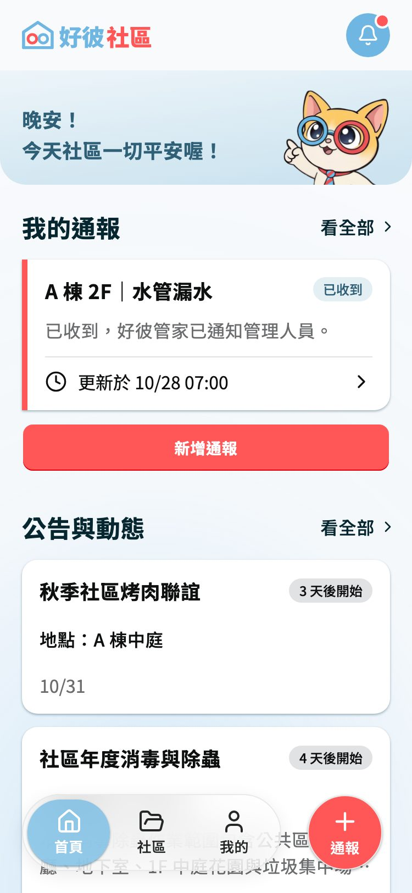
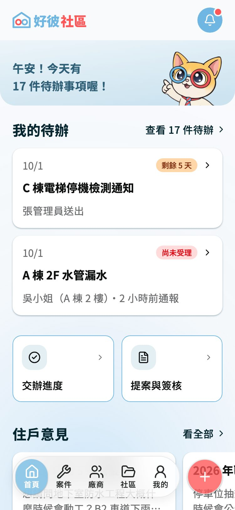
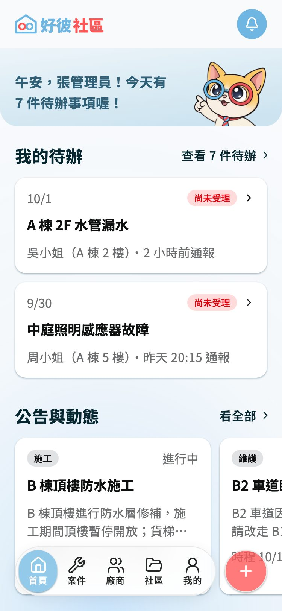

# 好彼社區 Hubitat

社區外包維修的紀錄與管理 App。住戶通報問題後可以隨時看到處理進度；管委會、管理人員把每一次維修記下來，累積成設備的維修史和廠商的施工表現，作為續約的依據。

**線上試用**：https://suzyoyo.github.io/hubitat/ （手機版，用電腦開請把瀏覽器縮窄，或用開發者工具切成手機畫面）
**使用手冊**：https://suzyoyo.github.io/hubitat/help/

> 🚧 開發中：主要流程（通報到結案）已經可以從頭走完，其他頁面持續補上。截圖由 `npm run shoot:help` 從 App 自動截取，畫面改版後重截即可更新。

<p>
  
  
  
</p>

## 解決什麼問題

- **住戶**：通報後常常「石沉大海」，不知道有沒有人處理、修到哪裡
- **管委會**：維修紀錄散在紙本和群組訊息裡，換屆時資料斷掉，也很難判斷廠商做得好不好、要不要續約
- **管理人員**（物業公司、警衛）：交辦、派廠商、完工回報沒有固定的流程

## 三種使用者

| 角色 | 能做什麼 |
|---|---|
| 住戶 | 通報問題（五個步驟，會提示相似的通報，可以按「我也遇到了」）、看處理進度、看公告和會議紀錄、留言 |
| 管委會 | 受理通報、交辦、結案；廠商名冊和合約、設備清冊和維修史、公告、提案與簽核 |
| 管理人員 | 處理交辦、派廠商、回報完工、快速留存單據照片 |

## 主要流程

```
住戶通報 → 管委會受理 → 交辦給管理人員 → 派廠商、完工驗收 → 主委或副主委結案 → 記進設備的維修史
```

三端看的是同一筆案件，每一步都會留下處理紀錄，也會通知相關的人。

### 怎麼試（約 5 分鐘）

0. 先打開 [`/playground`](https://suzyoyo.github.io/hubitat/playground) 最下面的「假資料」，把示範住戶切成**陳先生**（預設的李先生同時是主委，會變成自己受理自己的通報）
1. 回到首頁選「住戶」→ 右下角「通報」→ 選「B 棟・電梯／電梯口」→ 出現相似通報時按「都不是，我要通報新問題」→ 寫「運轉有異音」送出
2. 「我的」→「登出帳號」回到角色選擇頁，換成「管委會」→ 首頁「我的待辦」第一張就是剛剛的通報 → 受理 → 底部「交辦」給張管理員
3. 換成「管理人員」→ 首頁待辦第一張 → 廠商選「大同電梯」→ 更新進度 → 完工驗收
4. 換回「管委會」→ 結案 →「查看設備」看到維修紀錄多了一筆
5. 換回「住戶」→ 鈴鐺有結案通知

完整的示範步驟在 [`docs/case-flow.md`](docs/case-flow.md) 第 1 節。目前沒有後端，資料都是假的，改過的內容關掉分頁就會回到原本的樣子。

## 設計重點

- **長輩也是使用者**：內文 16px、按鈕和可以點的範圍至少 44px、「我的」裡可以調字體大小
- **吉祥物「好彼管家」**：通報送出、空狀態、載入失敗時出來說話，降低面對科技工具的焦慮
- **顏色代表要不要注意**：徽章紅、橘、藍、灰的意思在住戶端和管理端分開定義（[`docs/dev-guide.md`](docs/dev-guide.md) 第 5 節）
- **權限依角色**：合約金額、維修費用只有管委會看得到；只有主委、副主委能結案（[`docs/permissions.md`](docs/permissions.md)）
- **首頁新手導覽**：第一次進首頁時，一次亮一個真的按鈕說明用途
- **像 App 一樣用**：PWA，可以加到手機主畫面

## 技術

- Vue 3（JavaScript）＋ Vite
- Tailwind CSS v4 ＋ shadcn-vue
- Vue Router（網址分成 `/resident`、`/committee`、`/staff` 三端）
- PWA：`vite-plugin-pwa`
- 假 API：`src/mocks/`，全部回傳 Promise、延遲 400ms，畫面只透過它拿資料，之後換成真的後端不用改畫面
- 部署：GitHub Actions，合併進 `main` 後自動部署到 GitHub Pages

## 協作方式

兩人開發，設計稿在 Figma，元件庫「好彼 Kit」從 shadcn 延伸。一頁一個分支、每個改動都開 PR，動到共用的東西（設計 Token、基礎元件、假資料、規則文件）要對方 review 才合併（[`docs/git-workflow.md`](docs/git-workflow.md)）。開發時用 [Claude Code](https://claude.com/claude-code) 協作寫程式，規格、設計和取捨由我們決定。

## 在自己的電腦跑

需要 Node.js 20.19 或 22.12 以上（Vite 8 的要求）。

```bash
npm install
npm run dev          # App，http://localhost:5173
npm run dev:help     # 使用手冊，http://localhost:5180
npm run build        # 打包（PWA 只有打包後才有）
```

## 文件

| 文件 | 內容 |
|---|---|
| [`docs/product-brief.md`](docs/product-brief.md) | 產品簡介、品牌、主打功能 |
| [`docs/case-flow.md`](docs/case-flow.md) | 案件流程與示範故事 |
| [`docs/permissions.md`](docs/permissions.md) | 誰能做什麼 |
| [`docs/data-model.md`](docs/data-model.md) | 假資料的規劃 |
| [`docs/dev-guide.md`](docs/dev-guide.md) | 寫程式的規則（按鈕、徽章、表單、篩選…） |
| [`docs/component-map.md`](docs/component-map.md) | Figma 元件和程式的對照 |
