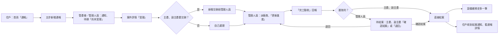

# 好彼社區 Hubitat — 使用手冊規劃交接文件

> **這份文件是什麼**：給下一位 AI 設計顧問的「產品現況說明書」，用來規劃網頁版使用手冊（Help Center）的內容架構、UI/UX 與開發指令。
>
> **怎麼來的**：2026-10-18 直接檢查專案程式碼（路由、頁面、元件、假資料、設定檔）與專案內的規格文件整理而成，以分支 `shared/case-deadline-category` 的狀態為準（比 `main` 多了一個「案件問題分類」的小改動）。
>
> **標示方式**：
> - ✅ 已實作：畫面做好、按鈕按得動
> - 🟡 部分完成：畫面有了，但有一部分是假的或還沒做
> - ⬜ 尚未實作：只有「這一頁還沒製作」的佔位頁，或完全沒有
> - 「【推測】」開頭的句子是分析者的判斷，不是程式裡寫死的事實
>
> **團隊已確認的手冊範圍（2026-10-18）**：
> 1. **三端都要寫**：住戶、管委會、管理人員
> 2. **做成獨立網站**：App 裡「我的」→「使用說明」點了就連到這個網站
> 3. 因為是獨立網站，要有一段**產品介紹**，保留「好彼社區 Hubitat」名稱
> 4. **只寫已經做好的功能**（✅ 與 🟡 裡做好的部分）。⬜ 的功能之後不會上線，手冊不要提，也不要寫「即將推出」
> 5. 不寫進手冊：字體大小、下載會議紀錄／合約 PDF、加入管委會的 QR Code 掃描與邀請碼規則（之後的擴充功能）、語音或影片教學
> 6. 登入方式之後補；客服支援管道先放假資料
> 7. Figma 設計稿不用管，**一律以程式畫面為準**
>
> 完整的回覆在[第 9 節](#9-尚待確認的資訊)。

> **最重要的前提（請先讀）**：這個 App 目前是**原型**，沒有真的後端、沒有登入。所有資料都是假資料，存在瀏覽器裡，**關掉 App 就會回到原本的樣子**（2026-10-20 起重新整理不會清掉）。使用手冊要寫的是「正式上線後使用者會怎麼用」，但目前只能根據原型的畫面與規則來寫；凡是原型裡是假的部分（例如上傳照片只記檔名、下載 PDF 只跳提示），本文都會註明。

---

## 目錄

1. [產品基本資訊](#1-產品基本資訊)
2. [完整功能清單](#2-完整功能清單)
3. [各功能的實際操作流程](#3-各功能的實際操作流程)
4. [資訊架構與導覽方式](#4-資訊架構與導覽方式)
5. [現有 Design System](#5-現有-design-system)
6. [前端技術架構](#6-前端技術架構)
7. [使用手冊素材盤點](#7-使用手冊素材盤點)
8. [初步使用手冊架構建議](#8-初步使用手冊架構建議)
9. [尚待確認的資訊](#9-尚待確認的資訊)

---

## 1. 產品基本資訊

### 1-1 名稱與定位

| 項目 | 內容 | 來源 |
|---|---|---|
| 中文名稱 | 好彼社區 | `docs/product-brief.md`、`index.html` 的 `<title>` |
| 英文名稱 | Hubitat | 同上 |
| 命名由來 | 「好彼」取 Hubitat 前兩個音節的諧音，概念是「美好彼此」；Hubitat ＝ Hub（資訊樞紐）＋ Habitat（居住生態） | `docs/product-brief.md` |
| 一句話定位 | 社區外包廠商進駐維修的紀錄與管理平台：住戶能即時看社區狀態，管委會能方便查資料、檢討廠商品質、決定要不要續約 | `docs/product-brief.md` |
| 形態 | **只做手機版**的網頁，可以「加到主畫面」像 App 一樣打開（PWA）。桌機打開時，畫面是置中的一條手機寬度欄位 | `vite.config.js`、`src/layouts/AppShell.vue` |
| 競品 | 「智生活」APP | `docs/product-brief.md` |
| 吉祥物 | **好彼管家**：在通報送出、空白畫面、提示框等地方出現，降低長輩使用科技的焦慮 | `docs/product-brief.md`、`src/assets/mascot/` |
| 目前版本 | V0.1.0（「我的」頁最下面顯示「好彼社區 V0.1.0」） | `package.json` |

### 1-2 主要解決的問題

1. **通報後石沉大海**：住戶報修後不知道有沒有人處理、處理到哪裡。→ 通報後可以隨時看進度，每一步都有給住戶看的說明。
2. **管委會換屆資訊斷層**：會議決議、合約、廠商紀錄散落各處。→ 會議紀錄、合約、設備維修史集中存放、可以搜尋。
3. **不知道廠商好不好**：缺少廠商的施工紀錄可以檢討。→ 廠商名冊有施工表現統計（平均修復天數、報修件數、保養完成率）、服務紀錄。

### 1-3 目標使用族群

| 族群 | 說明 |
|---|---|
| 住戶 | 社區所有住戶，**包含長輩**。程式裡因此把內文放大到 16px、可點的按鈕至少 44px 高、刪除用文字按鈕不用叉叉 |
| 管委會委員 | 主委、副主委、財務委員、一般委員（修繕、監察）。多半也是住戶，可以在兩端之間切換 |
| 管理人員 | 物業公司的總幹事、管理員、警衛 |
| （不是使用者）廠商 | 廠商是被記錄、被評價的對象，不會登入 App |

### 1-4 核心功能（依產品文件與實作程度排序）

1. **報修閉環**（完成度最高）：住戶通報 → 管委會或管理人員受理 → 交辦給管理人員 → 派廠商、更新進度 → 完工驗收 → 主委、副主委結案 → 自動記進設備的維修歷史 → 住戶收到結案通知
2. **社區公告與行事曆**：施工、維護、活動等公告，住戶看「與我有關」的；管理端發布、審核、撤回
3. **會議紀錄與住戶留言**：住戶看遮蔽過個資的住戶版會議紀錄、全文搜尋、留言給管委會
4. **廠商名冊與合約**：廠商聯絡、施工表現、合約期間與文件、負責設備
5. **待辦與交辦**（管理端）：每個人的「我的待辦」把要處理的事集中起來；主委、副主委可以把事情交辦給管理人員

（產品文件提到的第二大模組「管委會交接包」目前**還沒有畫面**，只有假資料。）

### 1-5 典型使用情境

| 情境 | 誰 | 做什麼 |
|---|---|---|
| 電梯有異音 | 住戶 | 首頁按右下角「通報」，五個步驟送出；之後在「我的通報」看進度，結案時收到通知 |
| 有人通報過一樣的問題 | 住戶 | 通報流程第 2 步看到別人已通報的同一地點問題，按「我也遇到了」，不用重複通報 |
| 停水施工 | 住戶 | 首頁「公告與動態」看到紅色「今天開始」的公告，點開看注意事項 |
| 想知道管委會開會決定了什麼 | 住戶 | 首頁的會議卡 →「閱讀會議紀錄完整版」，搜尋關鍵字；有疑問就按右下角「留言」 |
| 收到新通報 | 主委／副主委／管理人員 | 鈴鐺出現紅點、待辦出現紅色「尚未受理」→ 進案件詳情按「受理」 |
| 把事情交給管理員處理 | 主委／副主委 | 案件詳情按「交辦」，選管理人員、填期限 |
| 廠商到場維修完 | 管理人員 | 案件詳情按「完工驗收」，附照片、備註後回報 |
| 確認並結案 | 主委／副主委 | 待辦出現「待我結案」→ 案件詳情按「確認結案」，填維修費用與結案說明 |
| 半夜水管爆裂要找廠商 | 管委會／管理人員 | 「廠商」分頁的「廠商緊急聯絡」一鍵撥號；鑰匙清單看鑰匙放哪裡 |
| 檢討廠商要不要續約 | 管委會 | 廠商詳細看施工表現、服務紀錄；「廠商合約」看合約期間與金額 |

### 1-6 使用者角色與權限

App 用網址區分三端：`/resident`（住戶）、`/committee`（管委會）、`/staff`（管理人員）。**目前沒有登入**，首頁 `/` 是「開發預覽：請選擇要查看的角色」頁，選了就進入那一端。

| 角色 | 進入的端 | 示範的人（假資料） | 能做的重點 |
|---|---|---|---|
| 住戶 | 住戶端 | 李先生（同時是主委）、陳先生（一般住戶） | 通報、我也遇到了、修改自己的通報、看公告、看會議紀錄並留言、加入管委會 |
| 主委 | 管委會端 | 李主委 | 幾乎所有事：受理、交辦、結案、退回、發布與審核公告、看合約金額、交接與設定 |
| 副主委 | 管委會端 | 張副主委 | 同主委（唯一例外：發布住戶版會議摘要只有主委） |
| 財務委員 | 管委會端 | 陳財務 | 看資料、新增通報、提案與簽核、上傳合約與財務報告；**不能**受理、交辦、結案、發布公告 |
| 一般委員（修繕、監察） | 管委會端 | 王修繕、林監察 | 看資料、新增通報、提案與簽核；**不能**受理、交辦、結案、發布公告 |
| 管理人員 | 管理人員端 | 張管理員、王總幹事、黃組長 | 受理、派廠商、更新進度、完工驗收、發布公告（要審核，緊急的直接發布）；**不能**結案、交辦給別人、看合約金額與維修費用、看會議內部資料 |

權限的完整對照表在 `docs/permissions.md`。重要原則：**沒有權限的按鈕直接不顯示**（不是顯示成灰色），因為長輩會以為壞掉。→ 使用手冊要提醒「看不到某個按鈕，可能是你的身分沒有這個權限」。

住戶端看不到的資訊（程式刻意拿掉）：合約金額、維修費用、會議表決票數、處理人姓名、逾期天數、附議人數。

---

## 2. 完整功能清單

「對應路由」都省略網址開頭的端，例如 `reports/new` 在住戶端就是 `/resident/reports/new`。

### 2-1 共用

| 功能分類 | 功能名稱 | 功能用途 | 操作入口 | 對應頁面或路由 | 狀態 |
|---|---|---|---|---|---|
| 進入 App | 角色選擇 | 選擇要用哪一端（代替登入） | 打開網站 | `/`（`views/RoleSelectView.vue`） | ✅（開發用，正式版會換成登入頁） |
| 進入 App | 登入／註冊 | — | — | — | ⬜ 沒有 |
| 進入 App | 加到手機主畫面（PWA） | 像 App 一樣全螢幕打開 | 手機瀏覽器的「加到主畫面」 | `vite.config.js` | ✅（只有正式打包版有效） |
| 外框 | 通知鈴鐺 | 有未讀通知時有紅點 | 每個分頁右上角 | `notifications` | ✅ |
| 外框 | 返回 | 回上一頁；沒有上一頁就回首頁 | 內頁左上角 | `components/app/AppHeader.vue` | ✅ |
| 我的 | 字體大小（小／中／大） | — | 「我的」→ 顯示設定 | `me` | 🟡 **只有外觀**：會記住選擇，但字不會真的變大小。**不寫進手冊** |
| 我的 | 個人資料、通知設定、使用說明、帳號與安全 | — | 「我的」頁 | `me/profile`、`me/notifications`、`me/help`、`me/account` | ⬜ 佔位頁 |
| 我的 | 登出帳號 | 回到角色選擇頁 | 「我的」頁底部 | `/` | ✅（目前只是回到角色選擇頁） |

### 2-2 住戶端（`/resident`）

| 功能分類 | 功能名稱 | 功能用途 | 操作入口 | 對應頁面或路由 | 狀態 |
|---|---|---|---|---|---|
| 首頁 | 首頁總覽 | 問候語、最新的進行中通報、與我有關的公告（前 2 則）、最新會議 | 底部「首頁」 | `home`（`views/resident/HomeView.vue`） | ✅ |
| 通報 | 新增通報（五步） | 通報公共區域或住戶行為的問題 | 右下角紅色「＋通報」、首頁「新增通報」按鈕 | `reports/new`（`NewReportView.vue`） | ✅（照片只記檔名，沒有真的上傳與預覽） |
| 通報 | 我也遇到了 | 對別人已通報的同一問題表示「我也遇到了」 | 新增通報第 2 步 | `reports/new?step=2` | ✅ |
| 通報 | 我的通報 | 看自己的通報，分「進行中」「已完成」 | 首頁「我的通報 看全部」 | `reports`（`ReportsView.vue`） | ✅ |
| 通報 | 通報詳情（看進度） | 看通報摘要、處理進度條、處理紀錄 | 點通報卡、通知 | `reports/:id`（`ReportDetailView.vue`） | ✅ |
| 通報 | 修改通報 | 改補充說明、照片 | 通報詳情（自己的、還沒結案的才有） | `reports/:id` | ✅ |
| 通報 | 撤回通報 | — | — | — | ➖ 刻意不做（2026-10-15 決定拿掉） |
| 公告 | 社區公告 | 看社區行事曆、「與我有關」「社區公告」兩個分頁 | 首頁「公告與動態 看全部」 | `announcements`（`AnnouncementsView.vue`） | ✅ |
| 公告 | 公告詳情 | 看公告的時間、地點、注意事項 | 點公告卡、通知 | 彈窗（`components/notice/NoticeDetailDialog.vue`） | ✅ |
| 會議 | 會議紀錄（重點摘要／全文） | 看住戶版會議紀錄、目錄跳段、全文搜尋 | 首頁會議卡「閱讀會議紀錄完整版」 | `meetings/:id`（`MeetingDetailView.vue`） | ✅ |
| 會議 | 下載會議紀錄（PDF） | 下載遮蔽過個資的版本 | 會議紀錄頁首 | 同上 | 🟡 只跳「已開始下載」提示，沒有真的檔案 |
| 會議 | 留言給管委會 | 對會議紀錄提問（300 字內） | 會議紀錄右下角「留言」 | 同上（底部滑出的抽屜） | ✅ |
| 會議 | 我的留言 | 看自己的留言與管委會回覆 | 留言送出後「查看我的留言」、「我的」→ 我的紀錄 | `me/comments`（`MyCommentsView.vue`） | ✅ |
| 通知 | 通知 | 看結案、公告、留言回覆等通知；全部已讀 | 右上角鈴鐺 | `notifications`（`NotificationsView.vue`） | ✅（受理、派廠商時還不會通知住戶，只有結案會） |
| 我的 | 我的 | 個人資料卡、身分、我的紀錄、顯示設定、系統與支援 | 底部「我的」 | `me`（`MeView.vue`） | ✅ |
| 我的 | 加入管委會（邀請碼） | 輸入主委給的 6 位數邀請碼加入管委會 | 「我的」→ 身分 →「加入管委會」（不是委員才有） | `me/join`（`JoinCommitteeView.vue`） | ✅（「開啟相機掃描」QR Code 還沒做） |
| 我的 | 切換至管委會 | 委員從住戶端切到管委會端 | 「我的」→ 身分（委員才有） | 連到 `/committee/home` | ✅ |
| 社區 | 社區分頁入口 | 搜尋框＋會議與決議、文件庫、設備三組選單 | 底部「社區」 | `files`（`FilesView.vue`） | 🟡 入口做好，點進去全是佔位頁 |
| 社區 | 管委會報告（會議列表）、社區時間軸、社區規約、公開文件、設備與維修史、搜尋 | — | 「社區」分頁 | `meetings`、`timeline`、`bylaws`、`documents`、`equipment`、`search` | ⬜ |

### 2-3 管委會端（`/committee`）

| 功能分類 | 功能名稱 | 功能用途 | 操作入口 | 對應頁面或路由 | 狀態 |
|---|---|---|---|---|---|
| 首頁 | 首頁總覽 | 問候語、我的待辦（前 2 筆）、捷徑（交辦進度、提案與簽核）、住戶意見、公告與動態 | 底部「首頁」 | `home`（`views/committee/HomeView.vue`） | ✅ |
| 待辦 | 我的待辦 | 「未完成／已完成」分頁、依類型篩選（全部、案件、交辦、需補資料、快到期文件、待簽核）、依到期日或建立日期排序 | 首頁「查看 N 件待辦」 | `todos`（`TodosView.vue`） | ✅ |
| 案件 | 案件列表 | 依狀態、地點篩選所有案件 | 底部「案件」 | `cases`（`CasesView.vue`） | ✅ |
| 案件 | 案件詳情 | 看住戶描述、照片；受理、改問題分類、選關聯設備、派廠商、寫處理紀錄、更新進度 | 點案件卡、待辦、通知 | `cases/:id`（`CaseDetailView.vue`，與管理人員端共用） | ✅ |
| 案件 | 受理 | 接下住戶通報 | 案件詳情底部「受理」（主委、副主委、管理人員） | 同上 | ✅ |
| 案件 | 交辦 | 把案件交給管理人員處理 | 案件詳情底部「交辦」（主委、副主委） | `tasks/new?caseId=…`（`NewTaskView.vue`） | ✅ |
| 案件 | 撤回交辦 | 收回交辦出去的案件 | 案件詳情底部「撤回交辦」（交辦的人） | 彈窗 | ✅ |
| 案件 | 完工驗收／回報完成 | 回報已修好（附件最多 5 個、備註 200 字） | 案件詳情底部「完工驗收」 | `cases/:id/complete`（`CaseCompleteView.vue`） | ✅（附件只記檔名） |
| 案件 | 退回 | 主委、副主委認為還要再處理，退回給管理人員 | 待結案的案件底部「退回」 | 彈窗 | ✅ |
| 案件 | 結案 | 填維修費用、結案說明後結案，自動記進設備維修史 | 待結案的案件底部「確認結案」 | `cases/:id/close`（`CaseCloseView.vue`） | ✅ |
| 案件 | 新增通報（代住戶登記） | 管委會自己通報，或替住戶登記（可選棟別、樓層、戶號） | 右下角「＋」→「新增通報」 | `cases/new`（`NewRepairView.vue`） | ✅ |
| 交辦 | 交辦進度 | 看自己交辦出去的事，依狀態篩選 | 首頁捷徑「交辦進度」 | `tasks`（`TasksView.vue`） | ✅ |
| 交辦 | 新增交辦 | 交辦標題、內容、對象、完成期限，可關聯案件 | 右下角「＋」→「新增交辦」、交辦進度頁 | `tasks/new` | ✅ |
| 交辦 | 交辦詳情 | 確認完成、退回說明、撤回交辦、回報完成 | 交辦進度、待辦 | `tasks/:id`（`TaskDetailView.vue`） | ✅ |
| 交辦 | 交辦回報完成 | 沒有關聯案件的交辦，回報完成 | 交辦詳情「回報完成」 | `tasks/:id/report`（`TaskReportView.vue`） | ✅ |
| 提案 | 提案與簽核列表 | 看提案、篩選「等我簽核／已通過／已否決」 | 首頁捷徑「提案與簽核」 | `proposals`（`ProposalsView.vue`） | ✅ |
| 提案 | 提案詳情、簽核、新增提案 | — | 列表的「前往簽核」「新增提案」 | `proposals/:id`、`proposals/new` | ⬜ |
| 公告 | 發布公告 | 選類型、填標題內容、範圍、日期時間、關聯案件與設備、緊急、推播方式 | 右下角「＋」→「發布公告」（主委、副主委） | `announcements/new`（`AnnouncementFormView.vue`） | ✅ |
| 公告 | 公告詳情 | 看公告、發布紀錄；修改、撤回、復原 | 首頁「公告與動態」的卡片 | `announcements/:id`（`AnnouncementDetailView.vue`） | ✅ |
| 公告 | 修改公告 | 同發布表單 | 公告詳情「修改公告」 | `announcements/:id/edit` | ✅ |
| 公告 | 公告與動態列表、住戶意見列表 | — | 首頁「看全部」 | `announcements`、`opinions` | ⬜ |
| 廠商 | 廠商分頁 | 搜尋；廠商緊急聯絡、社區內部聯絡（可一鍵撥號）、鑰匙清單 | 底部「廠商」 | `vendors`（`VendorsView.vue`） | ✅ |
| 廠商 | 廠商名冊 | 用「遇到的問題或廠商」搜尋、排序 | 廠商分頁「廠商名冊」 | `vendors/list`（`VendorListView.vue`） | ✅ |
| 廠商 | 廠商詳細 | 施工表現、聯絡窗口、合約資訊、負責設備、服務紀錄 | 點廠商 | `vendors/:id`（`VendorDetailView.vue`） | ✅ |
| 廠商 | 新增廠商 | — | 廠商名冊「新增廠商」 | `vendors/new` | ⬜ |
| 社區 | 社區分頁入口 | 搜尋框＋會議與決議、文件庫、設備三組 | 底部「社區」 | `files`（`FilesView.vue`） | ✅ |
| 社區 | 廠商合約列表、合約詳情 | 搜尋、依狀態篩選；看合約資訊、翻頁看合約文件、下載 PDF、歷次合約 | 社區分頁「廠商合約」 | `contracts`、`contracts/:id` | ✅（下載只跳提示） |
| 社區 | 設備清冊、設備詳情 | 搜尋、依狀態與地點篩選；看設備資訊、保養、維修史 | 社區分頁「設備清冊」、案件詳情「查看設備」 | `equipment`、`equipment/:id` | ✅ |
| 社區 | 會議紀錄、決議事項、規約、社區規則與慣例、法定文件、社區時間軸、搜尋 | — | 社區分頁 | `meetings`、`resolutions`、`bylaws`、`rules`、`documents`、`timeline`、`search` | ⬜ |
| 全域新增 | 上傳文件、快速留存 | — | 右下角「＋」 | `files/upload`、`quick-saves/new` | ⬜ |
| 我的 | 我的 | 身分、切換至住戶、交接與設定（主委、副主委）、顯示設定、系統與支援 | 底部「我的」 | `me`（`MeView.vue`） | ✅ |
| 我的 | 緊急標示使用紀錄 | 看誰在什麼時候把公告標成「緊急」 | 「我的」→ 交接與設定 | `me/urgent-log`（`UrgentLogView.vue`） | ✅ |
| 我的 | 換屆交接、社區設定 | — | 「我的」→ 交接與設定 | `me/handover`、`me/settings` | ⬜ |
| 通知 | 通知 | 今天／昨天／更早分組、全部已讀、點了跳到對應頁 | 右上角鈴鐺 | `notifications` | ✅ |

### 2-4 管理人員端（`/staff`）

管理人員端很多頁面直接沿用管委會端的檔案（同一個畫面，依身分顯示不同按鈕）。

| 功能分類 | 功能名稱 | 功能用途 | 操作入口 | 對應頁面或路由 | 狀態 |
|---|---|---|---|---|---|
| 首頁 | 首頁總覽 | 問候語、我的待辦（前 2 筆）、公告與動態 | 底部「首頁」 | `home`（`views/staff/HomeView.vue`） | ✅（沒有捷徑和住戶意見） |
| 待辦 | 我的待辦 | 未完成／已完成；類型篩選（全部、案件、交辦給我的、需補資料） | 首頁「查看 N 件待辦」 | `todos`（`views/staff/TodosView.vue`） | ✅ |
| 案件 | 案件列表、案件詳情、受理、派廠商、更新進度、完工驗收 | 同管委會端，但**沒有交辦、結案、退回** | 底部「案件」、待辦、通知 | `cases`、`cases/:id`、`cases/:id/complete` | ✅ |
| 交辦 | 交辦詳情、回報完成 | 被交辦的事回報完成 | 待辦、通知 | `tasks/:id`、`tasks/:id/report` | ✅ |
| 廠商 | 廠商分頁 | 緊急聯絡、內部聯絡、鑰匙清單 | 底部「廠商」 | `vendors`（`views/staff/VendorsView.vue`） | ✅（先求有畫面） |
| 廠商 | 廠商名冊 | — | 廠商分頁 | `vendors/list` | ⬜ 管理人員端是佔位頁 |
| 社區 | 社區分頁入口 | 同管委會端，會議與決議沒有徽章 | 底部「社區」 | `files`（`views/staff/FilesView.vue`） | ✅ |
| 社區 | 設備清冊、設備詳情 | 同管委會端，但**維修史沒有費用**、廠商不能點 | 社區分頁「設備清冊」 | `equipment`、`equipment/:id`（`views/staff/`） | ✅ |
| 社區 | 其他社區內頁、合約 | — | 社區分頁 | `meetings`、`contracts` 等 | ⬜ |
| 公告 | 發布公告、公告詳情、公告與動態 | — | 右下角「＋」、首頁 | `announcements/new`、`announcements/:id`、`announcements` | ⬜ 管理人員端是佔位頁（管委會端的表單已有管理人員的審核邏輯，只是還沒接到 `/staff`） |
| 全域新增 | 新增通報、上傳文件、快速留存 | — | 右下角「＋」 | `cases/new`、`files/upload`、`quick-saves/new` | ⬜ 管理人員端是佔位頁 |
| 我的 | 我的 | 身分、顯示設定、系統與支援；「切換至住戶」只有綁定戶號的管理人員才有（假資料沒有這種人） | 底部「我的」 | `me`（`views/staff/MeView.vue`） | ✅ |
| 通知 | 通知 | 同管委會端 | 右上角鈴鐺 | `notifications` | ✅ |

### 2-5 開發用頁面（使用手冊不需收錄）

| 頁面 | 用途 |
|---|---|
| `/playground` 元件盤點頁 | 設計 Token、元件、假資料一覽；最下面「假資料」區可以把示範住戶在李先生（主委）和陳先生（一般住戶）之間切換 |
| 佔位頁（`views/PlaceholderView.vue`） | 還沒做的頁面會顯示「這一頁還沒製作，目前網址：…」 |

---

## 3. 各功能的實際操作流程

以下只寫 ✅ 與 🟡 的功能，步驟依程式實際的按鈕文字與判斷邏輯整理。按鈕名稱用「」標示，和畫面上的字一致。

### 住戶端

#### 3-1 新增通報

- **功能用途**：通報社區公共區域的問題（例如電梯異音），或住戶行為問題（例如深夜噪音），讓管理人員和管委會處理。
- **使用前提**：住戶端（目前沒有登入）。所有住戶都能通報。
- **操作入口**：任何分頁右下角紅色圓形「＋ 通報」；或首頁「我的通報」下面的「新增通報」按鈕。
- **詳細操作步驟**（上方有進度條，顯示「選擇地點／確認是否重複／選擇類型／描述問題／確認送出」）：
  1. **選擇地點**：好彼管家問「想通報哪裡的問題呢？」。先點範圍（例如「A 棟」），展開後點具體地點（例如「1F 大廳」「電梯／電梯口」，單選）。找不到就點「其他」，在輸入框自己填（20 字內，例如「5 樓住戶門口」）。按「下一步」。
  2. **確認是否重複**（有才會出現）：如果同一個地點已經有人通報、而且是公開、還沒結案的，會列出來，好彼管家問「最近有人通報過，看看是不是同一個問題？」
     - 是同一個問題 → 按那張卡片上的「我也遇到了」，直接到「我也遇到了」完成頁（見 3-2）
     - 都不是 → 按「都不是，我要通報新問題」
     - 沒有相似的通報 → 自動跳過這一步
  3. **選擇類型**：二選一（必選，沒選時按鈕下面會提示「請先選擇一項類型，才能繼續。」）
     - **公共通報**：例如設備故障、走道漏水、照明太暗。會公開給全體住戶，其他住戶看得到、也能按「我也遇到了」
     - **保密通報**：例如鄰居深夜噪音、違規停車、走廊雜物。只有管委會與管理室看得到
     - 不論哪一種，你的姓名與戶號都不會被其他住戶看到
     - 按「下一步」
  4. **描述問題**：上方顯示剛選的地點。
     - 「通報問題」（必填，紅色星號，20 字內，例如「感應門不會自動開」）
     - 「補充說明」（選填，200 字內，有字數顯示）
     - 「現場照片／影片」（選填，照片和影片合計最多 3 個，每段影片 50MB 以內；建議拍故障部位，避免拍到人臉與車牌）。每個檔案下面有「刪除」文字按鈕
     - 按「下一步：確認資料」
  5. **確認送出**：好彼管家說「最後確認，沒問題就送出！」，上方灰色框說明公開範圍或保密範圍，下面列出每一項資料，每一項都有「修改」可以回到那一步（改完要一步一步按回來）。底部小字「送出即表示你同意社區公約與通報規範。」按「送出通報」。
- **完成後結果**：完成頁顯示開心的好彼管家、「已收到你的通報！」「好彼管家已通知管理人員，會盡快處理。」「進度可到『我的通報』查看。」底部兩顆按鈕「查看我的通報」「回到首頁」。首頁與「我的通報」多一張狀態「已收到」的卡片。通報標題會自動組成「地點＋通報問題」，例如「電梯／電梯口運轉有異音」。管委會的主委、副主委和所有管理人員會收到「新的住戶通報」通知。
- **特殊情況**：
  - 必填沒填，「下一步」按不下去（按鈕變淡）
  - 影片超過 50MB，跳出紅色提示「影片太大了」
  - 送出失敗跳「送出失敗：請檢查網路後再試一次」
  - 按左上角返回會回到上一步；重新整理或中途資料遺失，會回到第 1 步
  - 有填東西時離開**不會**提醒（還沒做）
  - 原型限制：照片只記檔名，畫面上顯示圖示＋檔名。**正式版會有照片與影片預覽**（團隊確認），手冊照「有預覽」來寫
- **對應程式碼**：`src/views/resident/NewReportView.vue`、`src/components/report/ReportPlaceStep.vue`、`ReportSimilarStep.vue`、`ReportTypeStep.vue`、`ReportDescribeStep.vue`、`ReportConfirmStep.vue`、`ReportPhotoGrid.vue`、`src/views/resident/new-report/SubmittedDone.vue`、`src/lib/report.js`（字數與檔案上限）

#### 3-2 我也遇到了

- **功能用途**：別人已經通報過同一個問題時，表示自己也遇到了，不用重複通報；結案時也會收到通知。
- **使用前提**：新增通報第 2 步有出現相似通報。自己通報的、已經按過的不會出現按鈕。
- **操作入口**：新增通報第 2 步的通報卡片。
- **詳細操作步驟**：
  1. 在第 2 步看相似通報的卡片
  2. 確認是同一個問題，按「我也遇到了」
- **完成後結果**：顯示揮手的好彼管家完成頁，底部「查看這件通報」「回到首頁」。之後在「我的通報」看得到這件，但**只能看、不能修改**。
- **特殊情況**：通報已經結案時跳「送出失敗：這筆通報已經處理完了，請直接通報新問題。」
- **對應程式碼**：`src/components/report/ReportSimilarCard.vue`、`ReportSupportedDone.vue`、`src/mocks/api/cases.js`（`supportReport`）

#### 3-3 我的通報

- **功能用途**：查看自己通報（或按過「我也遇到了」、或同一戶被代登記）的所有通報。
- **使用前提**：無。
- **操作入口**：首頁「我的通報」右邊的「看全部 ›」。
- **詳細操作步驟**：
  1. 上方兩個分頁「進行中」「已完成」，點一下切換（「已完成」旁邊有件數）
  2. 每張卡片顯示標題、狀態徽章、地點、通報時間等；點卡片進入通報詳情
  3. 自己通報、還在進行中的卡片有「編輯通報 / 補充」，也是進到通報詳情
- **完成後結果**：—
- **特殊情況**：沒有通報時顯示拿放大鏡的好彼管家和「發現社區有問題，隨時可以通報喔！」
- **狀態顏色**（住戶端）：藍色「已收到」「處理中」＝跟你有關但不用做什麼；灰色「已完成」＝已結束。
- **對應程式碼**：`src/views/resident/ReportsView.vue`、`src/components/report/ReportCard.vue`、`src/lib/report.js`

#### 3-4 查看通報進度與修改通報

- **功能用途**：看通報處理到哪一步；補充說明或換照片。
- **使用前提**：看＝自己相關的通報都可以；**改＝只有自己通報、還沒結案的**。
- **操作入口**：「我的通報」或首頁的通報卡、結案通知。
- **詳細操作步驟**：
  1. 上方「通報摘要」卡：標題、狀態、地點、公開範圍（保密的寫「僅你本人與管委會可見」）
  2. 「處理進度」卡：進度條（已收到 → 處理中 → 已完成）與處理紀錄，例如「已安排廠商，預計 10/3 到場。」「維修已完成，等待管委會結案。」「已完成維修，感謝你的通報。」
  3. （可以修改時）下面出現「補充說明」（200 字）與「現場照片／影片」（最多 3 個）
  4. 改完按底部「確認修改」（沒有改東西時按不下去）
- **完成後結果**：跳提示「已更新通報」；處理進度多一筆「你修改了補充說明。」，下面灰色小字是改完的內容；管理端也看得到。
- **特殊情況**：
  - 通報已結案時跳「修改失敗：這筆通報已經不能修改了。」
  - 網址錯誤顯示「找不到這筆通報」與「回到我的通報」
  - 地點和通報問題（標題）不能改
  - **沒有撤回通報**；不需要處理的通報由管理端寫明原因結案
  - 住戶看不到內部分工（誰受理、交辦給誰、廠商名稱）
- **對應程式碼**：`src/views/resident/ReportDetailView.vue`、`src/components/report/ReportSummary.vue`、`ReportProgressCard.vue`、`ReportStepper.vue`、`ReportRecord.vue`

#### 3-5 社區公告

- **功能用途**：看施工、維護、活動等公告與社區行事曆。
- **使用前提**：無。
- **操作入口**：首頁「公告與動態」的「看全部 ›」；首頁的公告卡直接點則是開詳情彈窗。
- **詳細操作步驟**：
  1. 最上方「社區行事曆」：兩週的日期，有公告的日子有圓點（只能看，不能點）
  2. 兩個分頁「與我有關」「社區公告」（「與我有關」＝影響範圍包含你住的那一棟的公告，團隊確認），分頁上的數字是還沒看過的則數，打開那個分頁就算看過
  3. 點公告卡，跳出公告詳情彈窗：類型、範圍、日期時間、地點、注意事項（活動叫「活動說明」）
- **完成後結果**：分頁數字消失。
- **特殊情況**：沒有公告時顯示好彼管家和「有新公告時好彼管家會通知你。」從首頁或通知打開公告，目前不算「已讀」。
- **首頁公告卡的徽章**：紅色「施工中」「今天開始」、藍色「明天開始」、灰色「N 天後開始」。
- **對應程式碼**：`src/views/resident/AnnouncementsView.vue`、`src/components/calendar/CalendarCard.vue`、`src/components/notice/NoticeCard.vue`、`NoticeHomeCard.vue`、`NoticeDetailDialog.vue`、`src/lib/notice.js`

#### 3-6 閱讀會議紀錄

- **功能用途**：看管委會會議的住戶版紀錄（個資已遮蔽、沒有票數）。
- **使用前提**：只有管委會「已發布」的會議打得開。
- **操作入口**：首頁的會議卡「閱讀會議紀錄完整版」。（「社區」分頁的「管委會報告」列表還沒做。）
- **詳細操作步驟**：
  1. 頁首：社區管理委員會、會議名稱、日期、出席人數，與「下載會議紀錄（PDF）」
  2. 「重點摘要」分頁：核心決議＋議案列表，每案只顯示「通過」「下次續審」「報告事項」
  3. 「全文記錄」分頁：
     - 上方目錄標籤，點了跳到那一段
     - 搜尋框邊打邊搜，找到的字用橘色標示，結果列可以「上一處／下一處」（到底會繞回第 1 處）
     - 案由卡片預設全部展開，可以收合
     - 往下捲會出現「回到頂端」
- **完成後結果**：—
- **特殊情況**：搜尋沒結果顯示好彼管家＋「清除搜尋」；打不開的會議顯示「找不到這份會議紀錄」。「下載會議紀錄（PDF）」不是主要流程，**手冊不寫**。
- **對應程式碼**：`src/views/resident/MeetingDetailView.vue`、`src/components/meeting/`（`MeetingHead`、`MeetingCase`、`MeetingHighlight`）、`src/components/archive/ArchiveSearchResultBar.vue`

#### 3-7 留言給管委會與查看回覆

- **功能用途**：對會議紀錄提問，管委會回覆後收到通知。
- **使用前提**：已發布的會議。
- **操作入口**：會議紀錄頁右下角「留言」按鈕。
- **詳細操作步驟**：
  1. 按「留言」，從畫面底部滑出留言框（上方顯示會議名稱）
  2. 輸入留言（最多 300 字，只打空白不能送）
  3. 送出
  4. 成功畫面有「完成」「查看我的留言」
- **完成後結果**：留言出現在管委會首頁的「住戶意見」。「我的留言」頁有「全部」「待回覆」兩個分頁，「待回覆」的數字是還沒回覆的則數；藍色「待回覆」、灰色「已回覆」。管委會回覆後，住戶收到「管委會回覆了你的留言」通知，點了到「我的留言」。
- **特殊情況**：失敗跳「留言沒有送出：請稍後再試一次」。住戶只看得到自己的留言。留言卡片不能點回會議紀錄。管委會端「回覆住戶留言」的畫面**還沒做**（假資料裡有回覆）。
- **對應程式碼**：`src/components/app/AppMessage.vue`、`src/components/message/MessageSheetContent.vue`、`src/views/resident/MyCommentsView.vue`、`src/components/comment/`

#### 3-8 通知（三端相同）

- **功能用途**：集中看所有通知。
- **操作入口**：右上角藍色鈴鐺（有未讀時右上角有紅點）。
- **詳細操作步驟**：
  1. 通知依「今天／昨天／更早」分組，未讀的有紅點
  2. 點一則通知 → 跳到對應頁面（住戶：公告開彈窗、通報到通報詳情、會議留言到「我的留言」；管理端：案件詳情、交辦詳情、公告詳情等）
  3. 按「全部已讀」，所有紅點消失
- **特殊情況**：沒有通知時顯示「目前沒有通知」；公告已撤回時跳「這則公告已經撤回了」。
- **住戶什麼時候會收到通報的通知**（團隊確認）：**受理時**和**結案時**。⚠️ 程式目前只做了結案的通知，受理的通知待補；手冊照「受理、結案都會通知」來寫。
- **對應程式碼**：`src/views/resident/NotificationsView.vue`、`src/views/committee/NotificationsView.vue`、`src/views/staff/NotificationsView.vue`

#### 3-9 加入管委會

- **功能用途**：被選為委員的住戶，用主委給的邀請碼加入管委會。
- **使用前提**：還不是委員的住戶（委員看到的是「切換至管委會」）。
- **操作入口**：「我的」→「身分」→「加入管委會」。
- **詳細操作步驟**：
  1. **輸入邀請碼**：只能打數字，滿 6 位自動確認（顯示「正在確認邀請碼…」）。邀請碼由主委提供，72 小時內有效，只能用一次
  2. **確認邀請**：顯示「李主委邀請你加入管委會」、第幾屆、任期、這個職位可以做的事；按「接受邀請」或「婉拒」（婉拒會再跳確認：「婉拒後這組邀請碼就不能再使用」）
  3. **完成**：「已接受邀請！」、加入哪一屆擔任什麼，以及「生效前好彼管家會再通知你」；按「查看我的身分」或「回到首頁」
- **完成後結果**：「我的」頁的身分顯示「第 13 屆管委會・一般委員／2027/07/01 生效」＋藍色「待生效」。接受後不用審核，任期開始日才生效。
- **特殊情況**：錯誤的碼在輸入框下面顯示紅字：查無此碼、已過期、已使用。
- **手冊不寫的部分**（團隊確認是之後的擴充功能）：「開啟相機掃描」QR Code、邀請碼的有效期限（畫面寫 72 小時）、主委怎麼產生邀請碼。手冊只寫「輸入主委給你的 6 位數邀請碼」。
- **對應程式碼**：`src/views/resident/JoinCommitteeView.vue`、`src/views/resident/join-committee/`（`CodeStep`、`ConfirmStep`、`AcceptedDone`）
- ⚠️ 確認頁寫一般委員可以「簽核提案、廠商評分、新增交辦、查看管委會會議紀錄」，但一般委員**沒有**「新增交辦、廠商評分」的權限。團隊確認這段文字要改（程式待修），手冊照權限表寫：一般委員可以簽核提案、查看管委會會議紀錄。

#### 3-10 我的（三端類似）

- **內容**：個人資料卡（姓名、社區名稱、棟別戶號）、身分（目前身分＋切換或加入）、我的紀錄（住戶：我的留言）、顯示設定（字體大小小／中／大）、系統與支援（通知設定、使用說明、帳號與安全）、「登出帳號」、版本號。
- **管委會端多了**：「交接與設定」（主委、副主委才看得到）：換屆交接 ⬜、社區設定 ⬜、緊急標示使用紀錄 ✅。
- **手冊不寫**：字體大小（團隊決定先不做）；個人資料、通知設定、帳號與安全（佔位頁）。「使用說明」會改成連到手冊網站。
- **對應程式碼**：`src/views/resident/MeView.vue`、`src/views/committee/MeView.vue`、`src/views/staff/MeView.vue`、`src/components/app/MenuItem.vue`

### 管委會端與管理人員端

#### 3-11 我的待辦

- **功能用途**：把每個人要處理的事集中在一起（新通報、我負責的案件、待我結案、交辦給我的、待我確認、需補資料、快到期文件、待簽核）。
- **操作入口**：首頁「我的待辦」區塊（顯示最新 2 筆）右邊的「查看 N 件待辦 ›」。
- **詳細操作步驟**：
  1. 上方「未完成」「已完成」分頁
  2. 「類型」下拉選單篩選（管委會：全部、案件、交辦、需補資料、快到期文件、待簽核；管理人員是篩選標籤：全部、案件、交辦給我的、需補資料）
  3. 排序：到期日或建立日期
  4. 點卡片到對應的詳情頁
- **卡片怎麼讀**：徽章＋標題＋第二行說明「誰、什麼時候、做到哪裡」，例如「吳小姐（A 棟 2 樓）・2 小時前通報」「張副主委交辦・今天 18:00 前完成」。管理端徽章顏色：紅＝已經出問題（逾期、尚未受理）；橘＝輪到你處理或快到期；藍＝進行中、在等別人；灰＝已結束。
- **對應程式碼**：`src/views/committee/TodosView.vue`、`src/views/staff/TodosView.vue`、`src/components/admin/AdminActionCard.vue`、`AdminTodoCard.vue`、`src/mocks/api/todos.js`

#### 3-12 案件處理主流程（最重要）

案件狀態（管理端看到的文字／住戶看到的文字）：**待受理／已收到 → 處理中／處理中 → 待結案／處理中 → 已結案／已完成**

- **使用前提與權限**：

  | 動作 | 主委、副主委 | 財務、一般委員 | 管理人員 |
  |---|---|---|---|
  | 看所有案件 | ✓ | ✓ | ✓ |
  | 受理、改問題分類、選設備、派廠商、寫紀錄、完工驗收 | ✓ | ✗ | ✓ |
  | 交辦、撤回交辦 | ✓ | ✗ | ✗ |
  | 退回、結案 | ✓ | ✗ | ✗ |

- **操作入口**：待辦卡片、通知、底部「案件」分頁的列表（可用「狀態」「地點」下拉篩選，沒結果時有「清除篩選」）。
- **詳細操作步驟**：
  1. **受理**：打開「待受理」的案件，按底部「受理」→ 上方提示「已受理：接著可以選設備、派廠商」，狀態變「處理中」，負責人是你
  2. **整理資料**（都改在案件詳情的卡片裡，最後按一次底部「更新進度」一起存）：
     - 「問題分類」下拉：漏水、設備故障、照明、水電、門窗鎖具、噪音、其他（住戶通報時預設「其他」）
     - 「關聯設備」：可以打字搜尋設備清冊，選好後右邊出現「查看設備 ›」
     - 「廠商」：從名冊選或直接打名字，預約到場日期與時間
     - 「處理紀錄」：寫給管理端看的內容，另外可以寫一句「給住戶看的說明」（沒寫住戶就看不到這筆）
     - 按「更新進度」→ 提示「已更新進度」，「處理進度與留痕」多一筆，一項一行
  3. **（主委、副主委才有）交辦**：按底部「交辦」→ 新增交辦頁，關聯案件已鎖定；填「交辦標題」（必填）、「交辦內容」（選填）、「交辦對象」（必填，搜尋管理人員）、「完成期限」（選填）→「確認新增」→ 提示「已交辦：已通知 張管理員」。之後畫面上的負責人變成被交辦的人，底部變成「撤回交辦」「更新進度」
  4. **完工驗收**：按底部「完工驗收」→ 回報完成頁：上方是案件摘要；「附件」（選填，照片、影片、PDF 最多 5 個）、「備註說明」（選填，200 字）；主委、副主委自己做時多一欄「維修費用」（有關聯設備才有）→ 按「回報」→ 確認彈窗 → 回到案件詳情
     - **管理人員**按的 → 狀態變「待結案」，提示「已回報完成：等待主委、副主委結案」；主委和副主委都收到「案件待結案」通知、待辦出現「待我結案」
     - **主委、副主委**按的 → 直接結案
  5. **審核與結案**（主委、副主委）：打開「待結案」的案件，底部「退回」「確認結案」
     - 「退回」→ 彈窗填退回原因（必填）→「確認退回」→ 案件回到處理中，管理人員收到「交辦被退回」或「案件被退回」，待辦寫「已退回：原因」
     - 「確認結案」→ 結案頁：「維修費用」（選填，只有委員看得到，會記進設備維修紀錄）、「結案說明」（選填，住戶看不到）→「結案」→ 提示「已結案：已記進『電梯（B 棟）』的維修紀錄」
- **完成後結果**：
  - 有關聯設備的案件，結案後那台設備的維修史多一筆（日期、內容、廠商、費用，可點回案件）
  - 設備狀態跟著變：受理並關聯設備 → 待維修；廠商到場那天起 → 維修中；結案 → 正常使用中
  - 通報的住戶和按過「我也遇到了」的住戶收到「通報已結案」通知
  - 住戶在**受理時**也會收到通知（團隊確認的規則；程式待補）
- **特殊情況**：
  - 兩個人同時操作時，跳「沒有受理成功：可能已經有人受理了，請重新整理」等錯誤提示
  - 一件案件同時只能有一筆進行中的交辦
  - **沒有「驗收不通過」**：廠商當場驗收；要改天再來就是改預約時間；結案後又壞了就**再開一件新案件**，不重開舊的
  - 待結案的案件只能寫處理紀錄
  - 找不到案件顯示「找不到這件案件」＋「回到案件列表」
- **對應程式碼**：`src/views/committee/CaseDetailView.vue`、`CasesView.vue`、`CaseCompleteView.vue`、`CaseCloseView.vue`、`NewTaskView.vue`、`src/components/case/`（`CaseCategoryPicker`、`CaseEquipmentPicker`、`CaseVendorPicker`、`CaseLogForm`、`CaseAttachmentList`）、`src/mocks/api/cases.js`；完整規則在 `docs/case-flow.md`

#### 3-13 新增通報（代住戶登記）

- **功能用途**：管委會（或管理人員）自己發現問題通報，或接到住戶電話後代為登記。
- **使用前提**：管委會端所有委員都能用（管理人員端的這一頁目前是佔位頁）。
- **操作入口**：右下角「＋」→「新增通報」。
- **詳細操作步驟**：和住戶的五步流程一樣（選地點 → 確認重複 → 選類型 → 描述 → 確認送出），差別：
  - 多一欄「通報住戶」（選填）：選棟別、樓層、戶號，代那一戶登記，那一戶的住戶可以在「我的通報」追蹤進度；有「清除」可以取消
  - 第 2 步的按鈕是「都不是，我要登記新問題」
  - 完成頁按鈕是「查看案件」「回到首頁」
- **對應程式碼**：`src/views/committee/NewRepairView.vue`（重用 `src/components/report/` 的步驟元件，用 `management` 開關換說法）

#### 3-14 交辦進度與交辦詳情

- **功能用途**：主委、副主委追蹤交辦出去的事；被交辦的人回報完成。
- **操作入口**：管委會首頁捷徑「交辦進度」；右下角「＋」→「新增交辦」；待辦、通知。
- **詳細操作步驟**：
  1. 交辦進度頁：上方「新增交辦」按鈕；「狀態」篩選（全部、待我確認、已逾期、進行中、已完成）；標題寫「共 N 件未結案」「依到期日由近至遠排列」；每張卡有指派對象、完成期限，點「查看詳情」
  2. 交辦詳情（依身分顯示不同按鈕）：
     - **交辦的人**，對方已回報：「退回說明」「確認完成」→ 提示「已確認完成」
     - **交辦的人**，進行中：「撤回交辦」（要填撤回原因，無法復原）
     - **被交辦的人**：「回報完成」→ 有關聯案件的到案件的回報完成頁；沒有的到交辦回報頁（附件、備註）→ 提示「已回報完成：等待李主委確認」
  3. 退回時可以另外設定「新的完成期限」
- **徽章**：交辦的人看到橘色「待我確認」；被交辦的人回報後看到藍色「待確認」。
- **對應程式碼**：`src/views/committee/TasksView.vue`、`TaskDetailView.vue`、`TaskReportView.vue`、`NewTaskView.vue`、`src/lib/task.js`

#### 3-15 發布、修改、撤回公告

- **使用前提**：只有主委、副主委、管理人員能發布。主委、副主委發的直接發布；管理人員發的要主委或副主委審核，除非標示為緊急。**目前只有管委會端有畫面**。
- **操作入口**：右下角「＋」→「發布公告」；修改從公告詳情的「修改公告」。
- **詳細操作步驟**：
  1. 「公告類型」（必填）：施工、維護、活動、其他
  2. 填公告標題與內容（有字數顯示）
  3. 影響範圍（可多選，顯示「已選 N 項」，也可以選全社區）
  4. 日期：「單日」或「多日」，填日期、開始與結束時間（多日是每日的時間）
  5. 活動類多了「活動地點」（必填）、主辦單位
  6. 「關聯案件與設備」（灰色「僅管委會可見」徽章，選填，會記錄到社區時間軸與設備紀錄）
  7. 「標示為緊急」開關（說明：標示為緊急會直接發布，並同步通知管委會）
  8. 「推播通知」（必填）：通知影響範圍內住戶／通知全社區／不推播
  9. 送出 → 提示「公告已發布」（或管理人員的「已送出審核」）；修改後是「公告已更新」
- **公告詳情**：內容說明、發布紀錄；「修改公告」「撤回公告」（彈窗：「撤回後住戶將看不到這則公告，已收到通知的住戶會收到更正通知。」撤回原因選填 50 字）；撤回後可以「復原」。
- **特殊情況**：有欄位沒填好跳「還有欄位沒填好」；沒權限顯示「你沒有發布公告的權限」；已結束、已撤回、審核中或不是自己發的不能修改。
- **緊急標示使用紀錄**：「我的」→ 交接與設定 →「緊急標示使用紀錄」，看本年度、本月次數與每一筆的標示者。
- **對應程式碼**：`src/views/committee/AnnouncementFormView.vue`、`AnnouncementDetailView.vue`、`UrgentLogView.vue`、`src/mocks/api/announcements.js`

#### 3-16 廠商：緊急聯絡、名冊、詳細

- **操作入口**：底部「廠商」。
- **詳細操作步驟**：
  1. 廠商分頁：上方搜尋框（搜尋廠商、聯絡人、電話），三個區塊「廠商緊急聯絡」「社區內部聯絡」「鑰匙清單」；點電話就撥號
  2. 「廠商名冊」：用遇到的問題或廠商名稱搜尋（例如「漏水」），可排序（新增日期、名稱），顯示「共 N 家廠商」
  3. 點廠商進「廠商詳細」：統一編號、處理項目；施工表現（平均修復天數、報修件數、保養完成）；聯絡窗口（可撥號，有「緊急清單」標示）；合約資訊（「查看合約檔案（N 頁）」或紅色「無合約」）；負責設備（點了看維修歷程）；服務紀錄
- **權限差異**：管理人員看不到合約金額、不能下載合約；管理人員端目前沒有廠商名冊與廠商詳細頁。
- **對應程式碼**：`src/views/committee/VendorsView.vue`、`VendorListView.vue`、`VendorDetailView.vue`、`src/views/staff/VendorsView.vue`

#### 3-17 社區：廠商合約、設備清冊

- **廠商合約**（管委會端）：搜尋廠商或服務項目；狀態篩選（全部、即將到期、合約內、尚未生效）；排序（到期日、新增日期）。合約詳情：合約資訊、合約文件（點頁面放大，左右切換「上一頁／下一頁」）、上傳者與日期、歷次合約（含年金額）。（「下載 PDF」不是主要流程，手冊不寫。）
- **設備清冊**：搜尋設備名稱、位置或廠商；依狀態、地點篩選；排序「需要處理的在前」「保養日由近至遠」。設備詳情：設備資訊、保養（週期、下次保養）、維修史（從結案的案件自動進來，可點回案件）。設備狀態：正常使用中、待維修、維修中、已報廢；另外會算出「保養逾期」「保養將到期」。
- **權限差異**：管理人員端的維修史沒有費用、負責廠商不能點。
- **對應程式碼**：`src/views/committee/ContractsView.vue`、`ContractDetailView.vue`、`EquipmentListView.vue`、`EquipmentDetailView.vue`、`src/views/staff/EquipmentListView.vue`、`EquipmentDetailView.vue`

#### 3-18 提案與簽核（只有列表）

- **已做**：列表頁上方「法定效力說明：逐一簽核僅為委員意見紀錄，不等於開會表決。需執行之提案仍送管委會決議。」；「新增提案」按鈕；篩選（全部、等我簽核、已通過、已否決）；卡片顯示發起人、簽核進度、我的意見、簽核截止，按鈕「前往簽核」或「查看詳情」。
- **還沒做**：點進去的提案詳情、簽核動作、新增提案頁都是佔位頁，而且之後不會上線 → 【建議】**手冊不收錄提案與簽核**（列表上的按鈕都點不到真的內容）。
- **對應程式碼**：`src/views/committee/ProposalsView.vue`

---

## 4. 資訊架構與導覽方式

### 4-1 導覽元件

| 元件 | 長相 | 出現在哪 |
|---|---|---|
| 頂部列（品牌版） | 左邊「好彼社區」logo、右邊藍色圓形鈴鐺（未讀時有紅點） | 底部分頁的那幾頁 |
| 頂部列（內頁版） | 左邊「←」返回、中間標題 | 其他所有頁面（內頁、通知、流程頁）；這些頁面**沒有底部導覽** |
| 底部導覽 | 半透明白色膠囊，目前分頁是藍底白字 | 底部分頁的那幾頁 |
| 右下角圓形紅色按鈕 | 住戶：「＋ 通報」直接進新增通報；管委會、管理人員：「＋」在上方彈出「全域新增選單」 | 同上 |

全域新增選單（沒權限的項目不顯示）：新增交辦（只有主委、副主委）、新增通報、發布公告（主委、副主委、管理人員）、上傳文件 ⬜、快速留存 ⬜。

### 4-2 頁面階層（✅ 已做 🟡 部分 ⬜ 佔位頁）

```text
/  角色選擇（開發預覽，代替登入）
├─ /resident 住戶端
│  ├─ [分頁] 首頁 home ✅
│  │   ├─ 我的通報 reports ✅ → 通報詳情 reports/:id ✅
│  │   ├─ 社區公告 announcements ✅（公告詳情是彈窗）
│  │   └─ 會議紀錄 meetings/:id ✅ → 我的留言 me/comments ✅
│  ├─ [分頁] 社區 files 🟡
│  │   ├─ 搜尋 search ⬜
│  │   ├─ 管委會報告 meetings ⬜、社區時間軸 timeline ⬜
│  │   ├─ 社區規約 bylaws ⬜、公開文件 documents ⬜
│  │   └─ 設備與維修史 equipment ⬜
│  ├─ [分頁] 我的 me ✅
│  │   ├─ 個人資料 me/profile ⬜
│  │   ├─ 加入管委會 me/join ✅（或「切換至管委會」→ /committee/home）
│  │   ├─ 我的留言 me/comments ✅
│  │   └─ 通知設定 ⬜、使用說明 me/help ⬜、帳號與安全 ⬜、登出 → /
│  ├─ [鈴鐺] 通知 notifications ✅
│  └─ [＋通報] 新增通報 reports/new ✅（?step=1～5、完成頁）
│
├─ /committee 管委會端
│  ├─ [分頁] 首頁 home ✅
│  │   ├─ 我的待辦 todos ✅
│  │   ├─ 交辦進度 tasks ✅ → 交辦詳情 tasks/:id ✅ → 回報完成 tasks/:id/report ✅
│  │   ├─ 提案與簽核 proposals ✅ → 提案詳情 ⬜、新增提案 ⬜
│  │   ├─ 住戶意見 opinions ⬜（卡片連到 meetings/:id ⬜）
│  │   └─ 公告與動態 announcements ⬜；公告詳情 announcements/:id ✅ → 修改 :id/edit ✅
│  ├─ [分頁] 案件 cases ✅
│  │   └─ 案件詳情 cases/:id ✅
│  │       ├─ 交辦 tasks/new?caseId= ✅
│  │       ├─ 回報完成 cases/:id/complete ✅
│  │       ├─ 結案 cases/:id/close ✅
│  │       └─ 查看設備 equipment/:id ✅、查看廠商 vendors/:id ✅
│  ├─ [分頁] 廠商 vendors ✅
│  │   └─ 廠商名冊 vendors/list ✅ → 廠商詳細 vendors/:id ✅、新增廠商 ⬜
│  ├─ [分頁] 社區 files ✅
│  │   ├─ 搜尋 ⬜、會議紀錄 ⬜、決議事項 ⬜、規約 ⬜、社區規則與慣例 ⬜、法定文件 ⬜、社區時間軸 ⬜
│  │   ├─ 廠商合約 contracts ✅ → 合約詳情 contracts/:id ✅
│  │   └─ 設備清冊 equipment ✅ → 設備詳情 equipment/:id ✅
│  ├─ [分頁] 我的 me ✅
│  │   ├─ 切換至住戶 → /resident/home
│  │   ├─ 交接與設定：換屆交接 ⬜、社區設定 ⬜、緊急標示使用紀錄 me/urgent-log ✅
│  │   └─ 通知設定 ⬜、使用說明 ⬜、帳號與安全 ⬜、登出
│  ├─ [鈴鐺] 通知 ✅
│  └─ [＋] 新增交辦 ✅、新增通報 cases/new ✅、發布公告 announcements/new ✅、上傳文件 ⬜、快速留存 ⬜
│
└─ /staff 管理人員端
   ├─ [分頁] 首頁 home ✅ → 我的待辦 todos ✅、公告詳情 ⬜
   ├─ [分頁] 案件 cases ✅ → 案件詳情 ✅ → 回報完成 ✅、查看設備 ✅
   ├─ [分頁] 廠商 vendors ✅ → 廠商名冊 ⬜
   ├─ [分頁] 社區 files ✅ → 設備清冊 ✅ → 設備詳情 ✅；其他 ⬜
   ├─ [分頁] 我的 me ✅
   ├─ [鈴鐺] 通知 ✅ → 案件、交辦詳情 tasks/:id ✅
   └─ [＋] 新增通報 ⬜、發布公告 ⬜、上傳文件 ⬜、快速留存 ⬜（管理人員沒有新增交辦）
```

不存在的網址一律回到角色選擇頁 `/`。

### 4-3 最常見的操作路徑



其他常見路徑：

- 住戶：首頁 → 公告卡 → 公告詳情彈窗
- 住戶：首頁 → 會議卡 → 會議紀錄 → 搜尋／留言 → 我的留言
- 委員：住戶端「我的」→「切換至管委會」→ 管委會首頁（反過來是管委會「我的」→「切換至住戶」）
- 管理端：右上角鈴鐺 → 點通知 → 案件或交辦詳情

### 4-4 桌面版與手機版

- **App 本身只有手機版**。在桌機或平板打開時，整個畫面限制在最大 448px 寬（Tailwind `max-w-md`）並置中，導覽方式完全一樣，沒有側邊欄或桌機專屬導覽。
- 程式裡**沒有用任何 RWD 斷點**（沒有 `sm:`、`md:`、`lg:` 的版面切換）。
- 頂部列與底部導覽有處理 iPhone 瀏海與底部橫條（`safe-area-inset`）。
- 【推測】使用手冊要求支援 RWD，等於是這個專案第一個需要桌機版面的頁面，版面規則要另外設計。

---

## 5. 現有 Design System

設計 Token 都在 `src/style.css`，分三層：基礎色階 → 語意色（用途命名，換色改這層）→ 接到 Tailwind class。Figma 有對應的元件庫「好彼 Kit」。

### 5-1 顏色

**品牌與語意色**

| 用途 | Token | HEX | 說明 |
|---|---|---|---|
| 品牌主色 | `--primary` | `#6fb7e2` | 主要按鈕、鈴鐺底、目前分頁 |
| 品牌深色 | `--brand-strong` | `#457d9b` | |
| 品牌淺色 | `--brand-subtle`、`--secondary` | `#e4eff4` | 次要按鈕底、藍色徽章底、分頁選中 |
| 淺色上的深藍字 | `--secondary-foreground` | `#1b4354` | 灰底按鈕的字 |
| 區塊大標 | `--heading` | `#062630` | 「我的待辦」這類標題 |
| 頁面背景 | `--background` | `#f8fafc` | |
| 卡片底 | `--card` | `#ffffff` | |
| 主要文字 | `--foreground` | `#0e0f0f` | |
| 卡片內文 | `--text-secondary` | `#545656` | |
| 次要說明文字 | `--muted-foreground` | `#6c6d6e` | 日期、補充資訊 |
| 灰底 | `--muted` | `#e1e2e4` | |
| 分隔線、灰色徽章底 | `--border` | `#e1e2e4` | |
| 輸入框外框 | `--input` | `#c9cbcd` | |
| 警告（紅） | `--destructive`、`--warning` | `#ff5657` | 未讀紅點、錯誤 |
| 警告深 | `--warning-strong` | `#d64748` | 必填星號、刪除按鈕字 |
| 警告淺 | `--warning-subtle` | `#f5c6c8` | 紅色徽章底（字 `#85282a`） |
| 提醒（橘） | `--remind` | Tailwind orange-500（約 `#ff6900`） | 橘色徽章底是 orange-200、字 orange-900 |
| 進行中 | `--progress` | `#5a9abe` | |
| 完成 | `--success` | `#306077` | |
| 導覽列底 | `--nav` | 白色 72% 不透明 | |
| 目前分頁 | `--nav-active` | `#6fb7e2` 74% 不透明 | |
| 「＋」按鈕 | `--fab` | `#ff5657`（不透明） | |

**特殊背景**：首頁問候列是淺藍到白的漸層（`bg-header-panel`）；頁面左下角有淡藍光暈（`bg-page-glow`）。

**徽章顏色的意思**（重要，手冊可以直接用來教使用者「怎麼看顏色」）：

| 顏色 | 住戶端的意思 | 管理端的意思 |
|---|---|---|
| 紅 | 今天就會影響你（施工中、今天開始） | 已經出問題（逾期、尚未受理） |
| 橘 | 需要你動手做（請補充資料） | 輪到你處理或快到期 |
| 藍 | 跟你有關但不用做什麼（已收到、處理中、明天開始） | 進行中、在等別人 |
| 灰 | 已結束或只是分類（已完成、公告類型） | 已結束、正常或分類 |

**對比度待決定**：白字在品牌藍上約 2:1、白字在「＋」紅上約 3:1，都低於無障礙標準，目前照設計稿，之後可能調整。

### 5-2 字體與字級

- 字型：**Noto Sans TC**（Google Fonts，載入 400／500／700 三種粗細）
- 內文刻意從設計稿的 14px **放大到 16px**（給長輩閱讀）

| Class | 用途 | 大小／行高／粗細 |
|---|---|---|
| `type-title` | 區塊大標、內頁標題 | 22 / 33 / 700 |
| `type-card-title` | 卡片標題 | 18 / 25 / 700 |
| `type-greeting` | 好彼管家問候語、空狀態標題 | 18 / 24 / 700 |
| `type-body` | 內文 | 16 / 24 / 400 |
| `type-body-strong` | 內文粗體 | 16 / 24 / 500 |
| `type-link` | 「看全部」文字連結 | 16 / 20 / 500 |
| `type-date` | 日期、補充資訊（搭配灰色） | 16 / 20 / 400 |
| `type-note` | 備註小字 | 14 / 20 / 400 |
| `type-button` | 按鈕文字 | 14 / 20 / 700 |
| `type-nav` | 底部導覽文字 | 13 / 21 / 500 |
| `type-label` | 徽章 | 12 / 16 / 500 |

### 5-3 間距、圓角、陰影

- **間距**：用 Tailwind 的 4px 倍數。常見：頁面左右 20px（`px-5`）、區塊之間 32px（`space-y-8`）、區塊內 12～16px、卡片內距 16px（`p-4`）
- **圓角**：基準 `--radius` 10px → `rounded-sm` 6px、`rounded-md` 8px、`rounded-lg` 10px（按鈕、輸入框）、`rounded-xl` 14px（**新卡片的標準**）、`rounded-card` 20px（舊值，角色選擇頁與 shadcn Card 還在用，未統一）、徽章與導覽列是膠囊形
- **陰影**：`shadow-card`（帶藍色調的細陰影）、`shadow-nav`、`shadow-fab`

### 5-4 元件樣式

| 元件 | 規則 |
|---|---|
| 按鈕 | 高 44px（長輩好按），圓角 10px。`default` 品牌藍底白字＝主要動作；`outline` 灰底深藍字、**沒有外框**＝次要動作；`secondary` 淺藍底；`destructive` 淺紅底紅字；`ghost`、`link` 沒有底色。有底色的四種底部有 1px 深色線，看起來微微浮起 |
| 輸入框 | 高 44px；必填只用紅色星號 `*`，不寫「必填」；選填用灰色小字「選填」 |
| 卡片 | 白底、`rounded-xl`、`shadow-card` |
| 選單列（MenuItem） | 圖示＋標題＋說明＋右箭頭，用在「我的」「社區」頁 |
| 徽章 | 高 22px 膠囊形，四色規則見上 |
| 篩選 | 選項 4 個以內（含「全部」）用篩選標籤，5 個以上用下拉選單；可點範圍補到 44px |
| 底部固定按鈕區（BottomCta） | 流程頁、表單頁的主要按鈕固定在畫面底部 |
| 空狀態 | 好彼管家圖＋一句標題＋一句說明（有時加按鈕） |
| 提示訊息（Toast） | 畫面上方中央，成功／錯誤用不同顏色（vue-sonner） |
| 刪除 | 用「刪除」文字按鈕，不用叉叉（長輩比較看得懂） |

### 5-5 Icon、框架與風格

- **Icon**：Lucide（`@lucide/vue`）；另有一個自訂 `src/assets/icons/chat-edit.svg`
- **CSS 框架**：Tailwind CSS v4
- **元件庫**：shadcn-vue（底層是 Reka UI），原始碼已複製在 `src/components/ui/`，並已依好彼 Kit 改過顏色與尺寸
- **整體視覺風格**：明亮、淺藍色系、白色卡片配細陰影、大量圓角；吉祥物好彼管家帶出親切感；字大、按鈕大、說明直白，照顧長輩

### 5-6 尚未統一的地方

- 卡片圓角 20px（舊）與 14px（新）並存
- 對比度偏低（見上）
- 管委會、管理人員的 5 分頁導覽列還沒對照 Kit 樣式
- 「編輯通報 / 補充」按鈕樣式等設計稿三端統一
- 字體大小設定還沒真的生效

---

## 6. 前端技術架構

### 6-1 版本與套件（已安裝的實際版本）

| 項目 | 版本 | 用途 |
|---|---|---|
| Vue | 3.5.43 | 框架，**JavaScript（不用 TypeScript）**，全部用 `<script setup>` |
| Vite | 8.3.1 | 開發與打包 |
| Vue Router | 5.3.1 | 路由，`createWebHistory`（網址沒有 `#`） |
| Tailwind CSS | 4.3.3 | CSS（用 `@tailwindcss/vite`） |
| shadcn-vue | 2.8.2 | 元件（CLI 複製原始碼進專案） |
| Reka UI | 2.10.5 | shadcn-vue 的底層無障礙元件 |
| @lucide/vue | 1.49.0 | 圖示 |
| vue-sonner | 2.0.9 | 提示訊息 |
| @vueuse/core | 15.0.0 | 工具函式 |
| vite-plugin-pwa | 1.3.0 | 加到主畫面（只在打包版生效） |
| 套件管理 | npm | |

### 6-2 狀態管理

- **沒有 Pinia、Vuex**。每一頁用 `ref`、`computed` 自己管資料，透過假 API 拿資料
- 假 API（`src/mocks/api/`）：每種資料一個檔案，全部回傳 Promise、延遲 400ms，資料改在記憶體，**重新整理就還原**
- 「現在」固定是 `2026-10-01 13:42`（`MOCK_TODAY`、`MOCK_NOW`）
- 瀏覽器 `localStorage` 只存兩樣：字體大小（`hubitat-font-size`）、示範住戶（`hubitat-demo-resident`）
- 流程頁的「第幾步」記在網址上（例如 `?step=2`）

### 6-3 專案目錄

```text
src/
├─ main.js、App.vue            進入點；App.vue 只放 RouterView 與提示訊息
├─ style.css                   設計 Token 與文字樣式
├─ config/roles.js             三端設定：分頁、＋按鈕、全域新增選單、權限判斷
├─ router/                     index.js 組合；resident.js、committee.js、staff.js 各端頁面清單
├─ layouts/AppShell.vue        三端共用外框（頂部列＋底部導覽）
├─ views/                      頁面：resident/、committee/、staff/、playground/
├─ components/
│  ├─ ui/                      shadcn-vue 基礎元件（30 種）
│  ├─ app/                     外框與通用：AppHeader、BottomNav、AppGreeting、SectionHeader、MenuItem、BottomCta、AppMessage
│  ├─ report/ case/ admin/ notice/ meeting/ comment/ message/ calendar/ archive/ feedback/ common/
├─ lib/                        共用規則：date.js、report.js、notice.js、task.js、todo.js、utils.js
├─ mocks/                      data/（純資料）、api/（假 API）
└─ assets/                     logo/、mascot/、icons/、contract-pages/、IP/（吉祥物原圖，不 commit）
public/                        favicon.svg、icon/（PWA 圖示）
docs/                          規格文件（產品簡介、權限、案件流程、資料模型、開發規範、進度）
```

### 6-4 靜態資源

| 位置 | 內容 | 怎麼用 |
|---|---|---|
| `src/assets/logo/` | `logo1.svg`～`logo3.svg`（`logo2` 直式含 HUBITAT，`logo3` 橫式） | 在程式裡 `import` |
| `src/assets/mascot/` | 好彼管家 5 張，已縮小（各約 75～97KB）：`pointing`（指向，首頁問候）、`searching`（拿放大鏡，空狀態）、`thinking`（思考，提示框）、`waving`（揮手，我也遇到了完成頁）、`happy`（開心，送出完成頁） | 同上 |
| `src/assets/IP/` | 吉祥物原圖 6 張（每張約 3MB，**不能 commit**），多一張「驚訝坐著」還沒縮小使用 | 要用時先縮小再放進 `mascot/` |
| `src/assets/contract-pages/` | 合約頁面示意圖 | 合約詳情 |
| `public/icon/` | App 圖示（192、512、maskable、apple-touch-icon、1024 原檔） | 直接用網址 `/icon/...` |

### 6-5 Markdown 工具

**目前沒有任何 Markdown 處理套件**（沒有 markdown-it、marked、unplugin-vue-markdown 等）。
可以不裝套件的做法：

- 【推測】用 Vue 元件或 JavaScript 資料物件寫手冊內容（和假資料 `src/mocks/data/` 一樣的寫法），團隊最熟悉
- Vite 內建可以用 `?raw` 讀入純文字檔，但要顯示成格式化文章仍需自己處理或安裝套件
- 如果要用 Markdown 寫文章，需要新增依賴（例如 `markdown-it` 或 `unplugin-vue-markdown`），要先和團隊確認

### 6-6 手冊放在哪裡：獨立網站（團隊已決定）

團隊決定手冊做成**獨立網站**，App 裡「使用說明」點了就連過去。所以原本考慮的「在 App 裡加 `/help` 路由」不採用。

- **App 這邊要改的只有一件事**：三端「我的」頁「系統與支援」的「使用說明」（`me/help`，目前是佔位頁）改成連到手冊網站。【建議】依端連到對應章節，例如住戶連到住戶章節
- **手冊網站可以沿用的東西**：Vue 3 ＋ Vite ＋ Tailwind v4 的寫法、`src/style.css` 的設計 Token（顏色、`type-*` 文字樣式）、好彼管家與 logo 圖檔、`src/components/ui/` 的元件。【推測】做法可以是同一個 repo 裡另一個 Vite 專案（例如 `help/` 資料夾），把 `style.css` 與要用的元件共用，這部分請設計顧問與團隊決定
- **注意**：App 外框（`AppShell`）固定手機寬度 448px，手冊網站要支援 RWD，不能沿用這個外框
- **需要決定**：手冊網站的網址與部署位置（App 要連過去）

### 6-7 可以複用的現有元件（不用另外安裝）

| 用途 | 現有元件 |
|---|---|
| 按鈕、輸入框（搜尋）、徽章、分隔線 | `ui/button`、`ui/input`、`ui/badge`、`ui/separator` |
| FAQ 摺疊 | `ui/accordion`（會議紀錄的案由卡片已在用） |
| 角色切換（住戶／管委會／管理人員） | `ui/tabs`、`common/FilterChips` |
| 手機版目錄抽屜 | `ui/sheet`、`ui/drawer` |
| 提示框、注意事項 | `ui/alert`、`feedback/FeedbackHaobiTip`（好彼管家提示框） |
| 步驟說明 | `ui/stepper`、`report/ReportStepper` |
| 空狀態（搜尋不到） | `ui/empty` ＋ `mascot/searching.png` |
| 文章列表、目錄列 | `app/MenuItem`、`ui/item`、`app/SectionHeader` |
| 搜尋結果標示 | `meeting/MeetingHighlight`、`archive/ArchiveSearchResultBar` |
| 圖示方塊 | `common/IconTile` |
| 載入中 | `ui/skeleton`、`ui/spinner` |
| 卡片 | `ui/card`（圓角是舊的 20px）或直接用 `rounded-xl bg-card shadow-card` |
| 顏色、字級 | `style.css` 的 Token 與 `type-*` class 直接沿用 |

---

## 7. 使用手冊素材盤點

### 7-1 現有素材

| 素材 | 能不能用在手冊 |
|---|---|
| 好彼管家 5 張（`src/assets/mascot/`） | ✅ 可直接用：手冊首頁問候、FAQ、空狀態、完成提示 |
| 好彼管家原圖第 4 張「驚訝坐著」 | 可縮小後用在「疑難排解」「常見錯誤」 |
| Logo 3 種、App 圖示 | ✅ 手冊頁首、加到主畫面教學 |
| 操作截圖 | ❌ **專案裡沒有任何截圖或教學圖片** |
| Figma 設計稿（mockup 頁） | ❌ 不使用。團隊確認一律以程式畫面為準（設計稿和實作有多處不一樣） |
| 示範腳本 `docs/case-flow.md` 第 1 節 | ✅ 一步一步的示範故事，可以照著拍截圖 |

### 7-2 截圖的注意事項

- 用手機尺寸（例如 375×812）截圖
- 截之前到 `/playground` 選好示範住戶（李先生＝主委兼住戶，陳先生＝一般住戶），截完要切回李先生
- 截流程中途**不要重新整理**，假資料會還原
- 假資料的日期是 2026-10-01，截圖中的時間會是那天
- 照片、影片目前只顯示圖示＋檔名；正式版會有預覽，手冊截圖若要呈現預覽，需等程式補上或另外處理
- 截圖不要拍到「社區」分頁裡的佔位頁、字體大小設定、下載按鈕的提示
- 截圖裡的人名都是假資料，可以直接用

### 7-3 需要補的截圖清單

| 優先 | 頁面（網址） | 截圖內容 | 對應手冊步驟 |
|---|---|---|---|
| 高 | 住戶首頁 `/resident/home` | 整頁；標出右下角「通報」、鈴鐺、底部分頁 | 認識畫面、快速入門 |
| 高 | 新增通報第 1 步 `reports/new` | 展開一個範圍、選好地點、「其他」輸入框 | 3-1 步驟 1 |
| 高 | 新增通報第 2 步（選 A 棟・1F 大廳才會出現） | 相似通報卡＋「我也遇到了」 | 3-1 步驟 2、3-2 |
| 高 | 新增通報第 3 步 | 公共通報與保密通報兩張卡 | 3-1 步驟 3 |
| 高 | 新增通報第 4 步 | 填好通報問題、補充說明、照片格 | 3-1 步驟 4 |
| 高 | 新增通報第 5 步 | 確認頁、「修改」、「送出通報」 | 3-1 步驟 5 |
| 高 | 送出完成頁 | 好彼管家「已收到你的通報！」 | 3-1 完成 |
| 高 | 我的通報 `reports` | 進行中、已完成兩個分頁；空狀態 | 3-3 |
| 高 | 通報詳情 `reports/:id` | 進度條、處理紀錄；可修改時的補充說明與「確認修改」 | 3-4 |
| 中 | 社區公告 `announcements` | 行事曆、分頁數字、公告卡 | 3-5 |
| 中 | 公告詳情彈窗 | 從首頁公告卡打開 | 3-5 |
| 中 | 會議紀錄 `meetings/:id` | 重點摘要、全文記錄、搜尋結果橘色標示 | 3-6 |
| 中 | 留言抽屜、送出成功、我的留言 | | 3-7 |
| 中 | 通知 `notifications` | 未讀紅點、全部已讀 | 3-8 |
| 中 | 加入管委會三步（碼 `482913` 可用；`135790` 過期、`246810` 已使用可截錯誤畫面） | | 3-9 |
| 中 | 我的 `me`（李先生與陳先生各一張，身分區不同） | | 3-10、切換身分 |
| 高 | 管委會首頁 `/committee/home` | 待辦、捷徑、「＋」全域新增選單展開 | 管理端快速入門 |
| 高 | 我的待辦 `todos` | 篩選、各種徽章的卡片 | 3-11 |
| 高 | 案件詳情：待受理、處理中（各卡片可編輯）、交辦後、待結案（退回／確認結案） | 依 `docs/case-flow.md` 示範故事逐步截 | 3-12 |
| 高 | 新增交辦、回報完成、結案頁 | | 3-12 |
| 中 | 交辦進度、交辦詳情（交辦人與被交辦人兩種視角） | | 3-14 |
| 中 | 發布公告表單（含緊急開關、推播選項）、公告詳情、撤回彈窗 | | 3-15 |
| 中 | 廠商分頁、名冊、廠商詳細 | | 3-16 |
| 低 | 合約列表與詳情、設備清冊與詳情 | | 3-17 |
| 中 | 管理人員首頁、案件詳情（沒有交辦、結案按鈕的樣子） | | 管理人員章節 |
| 低 | 錯誤提示（toast）範例 | 例如「沒有受理成功」 | 疑難排解 |

### 7-4 適合的呈現方式

| 適合「圖文步驟」 | 適合「FAQ／疑難排解」 |
|---|---|
| 新增通報（五步）、我也遇到了、修改通報 | 為什麼我不能撤回通報？ |
| 看懂通報進度 | 為什麼我看不到某個按鈕？（權限） |
| 會議紀錄搜尋與留言 | 公開通報和保密通報差在哪？別人會看到我的名字嗎？ |
| 加入管委會 | 邀請碼不能用怎麼辦？（過期、已使用、查無此碼） |
| 管理端：受理 → 交辦 → 更新進度 → 完工驗收 → 結案 | 徽章的顏色是什麼意思？ |
| 發布公告 | 修好之後又壞了怎麼辦？（開新案件） |
| 加到手機主畫面 | 跳出「請重新整理」的錯誤怎麼辦？（有人同時在處理） |
| | 管理人員發的公告為什麼要審核？緊急公告怎麼用？ |
| | 為什麼住戶看不到處理人和廠商名稱？ |

---

## 8. 初步使用手冊架構建議

依產品特性調整的重點：

- **獨立網站**：第一次來的人可能還沒用過 App，所以首頁要先介紹產品
- **三種身分的人用的功能差很多**：首頁先讓人「選身分」
- **住戶有很多長輩**：住戶章節要特別簡單、圖大字大
- **管理端以「案件從頭到尾」的流程為主軸**
- **只寫已經做好的功能**：⬜ 的功能（社區分頁的內頁、提案簽核、換屆交接、上傳文件、快速留存、管理人員發布公告等）完全不提，也不寫「即將推出」

### 8-0 手冊首頁

- 好彼管家問候：「你想學什麼呢？」＋搜尋框
- 三個身分入口：我是住戶／我是管委會委員／我是管理人員
- 熱門文章：如何通報社區問題、怎麼看通報處理到哪裡、徽章顏色是什麼意思

### 8-1 認識好彼社區 Hubitat（產品介紹）

- 好彼社區是什麼？（名稱由來「美好彼此」、Hub ＋ Habitat）
- 好彼社區能幫你做什麼：報修進度透明、公告與會議紀錄集中、廠商紀錄可以檢討
- 三種身分各能做什麼
- 認識好彼管家

### 8-2 開始使用（三端共用）

- 把好彼社區加到手機主畫面（iPhone／Android）
- 登入（內容待團隊補充）
- 認識畫面：頂部鈴鐺、底部分頁、右下角按鈕、返回
- 看懂徽章顏色（住戶版、管理端版各一張表）
- 在住戶與管委會之間切換身分
- 查看通知、全部已讀

### 8-3 住戶：通報與追蹤

- 如何通報社區問題（五個步驟）
- 公共通報和保密通報怎麼選
- 有人通報過了：按「我也遇到了」
- 查看我的通報與處理進度
- 補充說明或更換照片
- 通報受理、結案時會收到通知

### 8-4 住戶：公告與會議

- 看社區公告與行事曆
- 「與我有關」的公告：影響範圍包含你住的那一棟
- 閱讀會議紀錄：重點摘要與全文
- 在會議紀錄裡搜尋關鍵字
- 留言給管委會、在「我的留言」查看回覆

### 8-5 住戶：我的與加入管委會

- 「我的」頁有什麼
- 用主委給的邀請碼加入管委會

### 8-6 管委會：日常工作

- 管委會首頁與「我的待辦」
- 看懂待辦卡片（徽章、第二行說明）
- 用「＋」快速新增：交辦、通報、公告
- 替住戶登記通報

### 8-7 管委會與管理人員：案件從通報到結案

- 案件的四種狀態（待受理、處理中、待結案、已結案），住戶看到的對照
- 受理案件
- 改問題分類、關聯設備、派廠商、寫處理紀錄、按「更新進度」
- 寫一句給住戶看的說明
- 處理期限與逾期
- 交辦給管理人員、撤回交辦（主委、副主委）
- 完工驗收與回報完成
- 審核：退回或確認結案（主委、副主委）
- 結案後設備維修史會自動更新
- 修好又壞了怎麼辦

### 8-8 管委會：交辦與公告

- 交辦進度：追蹤、確認完成、退回
- 被交辦時如何回報完成
- 發布公告、標示緊急、選推播方式
- 修改、撤回與復原公告
- 緊急標示使用紀錄

### 8-9 廠商、合約與設備

- 緊急時找廠商：一鍵撥號、鑰匙清單
- 廠商名冊與廠商詳細：怎麼看施工表現（管委會）
- 查合約期間、合約文件（管委會）
- 設備清冊、保養與維修史
- 各身分看得到的資訊差別（金額、費用）

### 8-10 管理人員專區

- 管理人員首頁與我的待辦
- 被交辦的案件怎麼處理
- 完工驗收後交給主委、副主委結案
- 管理人員能做與不能做的事

### 8-11 常見問題（FAQ）

見 7-4 右欄，依身分分組。

### 8-12 疑難排解

- 出現「請重新整理」的提示（別人剛好也在處理同一件）
- 按鈕按不下去（必填沒填、沒有改東西）
- 找不到某個按鈕（權限）
- 照片或影片傳不上去（數量、大小限制）
- 邀請碼錯誤（查無此碼、已過期、已使用）

### 8-13 聯絡支援（先放假資料）

團隊確認先放假資料，以下是建議的假內容，之後換成真的：

| 管道 | 假資料 |
|---|---|
| 社區管理室電話 | 02-1234-5678（週一至週日 08:00–22:00） |
| 客服信箱 | support@example.com |
| 服務時間說明 | 緊急狀況（漏水、停電、電梯受困）請直接撥打管理室電話 |

---

## 9. 尚待確認的資訊

### 9-1 團隊的回覆（2026-10-18）

| # | 問題 | 回覆 | 對手冊的影響 |
|---|---|---|---|
| 1 | 手冊給誰看？ | 三端都要 | 住戶、管委會、管理人員都有章節 |
| 2 | 放在哪裡？ | 獨立網站；App 的「使用說明」點了連過去 | 見 6-6 |
| 3 | 名稱 | 保留「好彼社區 Hubitat」，要簡單介紹產品 | 新增 8-1 產品介紹 |
| 4 | 登入方式 | 之後補 | 「登入」文章先留標題 |
| 5 | 尚未實作的功能 | 不會再上線 | 手冊只寫做好的功能，⬜ 的完全不提 |
| 6 | 字體大小 | 先不用做 | 不寫進手冊 |
| 7 | 住戶什麼時候收到通知 | 受理和結案時 | 照這個寫。⚠️ 程式目前只做了結案通知 |
| 8 | 客服支援管道 | 先放假資料 | 見 8-13 |
| 9 | 「社區公約與通報規範」 | 在社區內頁，這次範圍沒做 | 手冊不連結、不解釋 |
| 10 | 邀請碼規則 | 之後的擴充功能 | 只寫「輸入主委給的 6 位數邀請碼」，不寫有效期限、QR Code、怎麼產生 |
| 11 | 「與我有關」的公告 | 住戶住的那一棟 | 見 3-5 |
| 12 | 照片、影片 | 會有預覽 | 照「有預覽」寫 |
| 13 | 下載會議紀錄、合約 | 不是主要流程 | 不寫 |
| 14 | 處理期限 | 要保留 | 寫進案件章節（處理期限與逾期） |
| 15 | 語音、影片教學、長輩簡易版 | 不用 | 不做 |

### 9-2 程式裡發現的不一致（團隊的回覆）

| # | 地方 | 回覆 |
|---|---|---|
| 1 | 加入管委會確認頁寫一般委員可以「新增交辦、廠商評分」 | 一般委員沒有這兩項權限，**確認頁要改**（程式待修）；手冊照權限表寫 |
| 2 | 管理人員端「＋」選單的新增通報、發布公告是佔位頁 | 沒錯，還沒做；手冊不寫 |
| 3 | 管委會「住戶意見」「公告與動態」的「看全部」是佔位頁 | 同上 |
| 4 | 管委會端的會議紀錄、回覆住戶留言 | 不是主要流程，先不管；手冊不寫管委會怎麼回覆留言 |
| 5 | 假資料的「新報修待處理」 | **統一成「新通報」**，已改好並合併進 `main`（commit `47bdb4b`） |
| 6 | Figma 設計稿和實作不同 | 設計稿不管，以程式為主 |

### 9-3 還沒有答案的

- 登入方式（團隊之後補）
- 手冊網站的網址與部署位置（App 的「使用說明」要連過去）
- 手冊網站和 App 放在同一個 repo，還是另開一個？
- 手冊要不要沿用 App 的淺藍色系、好彼管家？（【推測】建議沿用，降低陌生感）
- 對比度偏低的配色（白字在品牌藍上約 2:1）手冊要不要先改用深一點的藍？
- 桌機版面沒有任何既有規則，需要設計顧問定義斷點與版面
